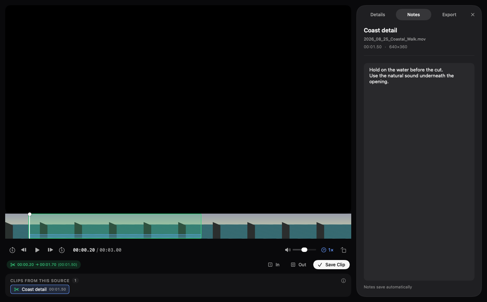
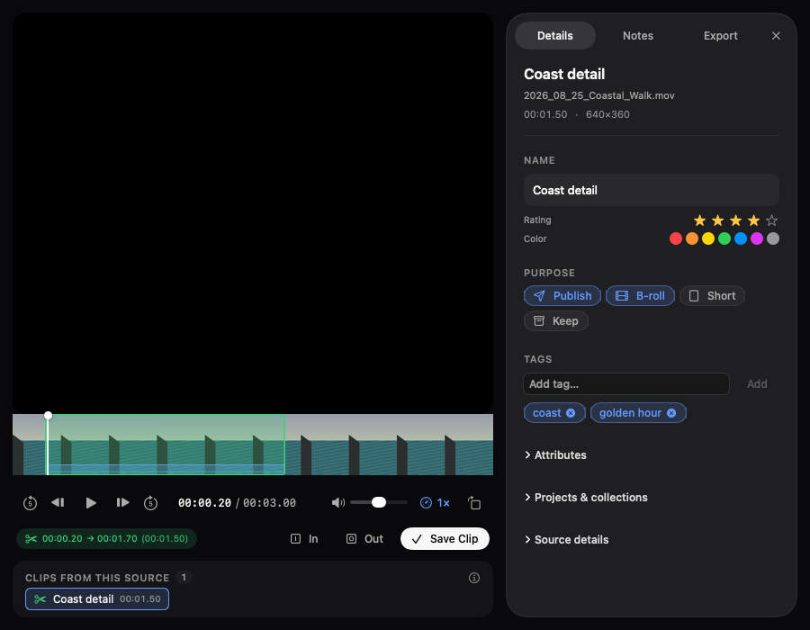
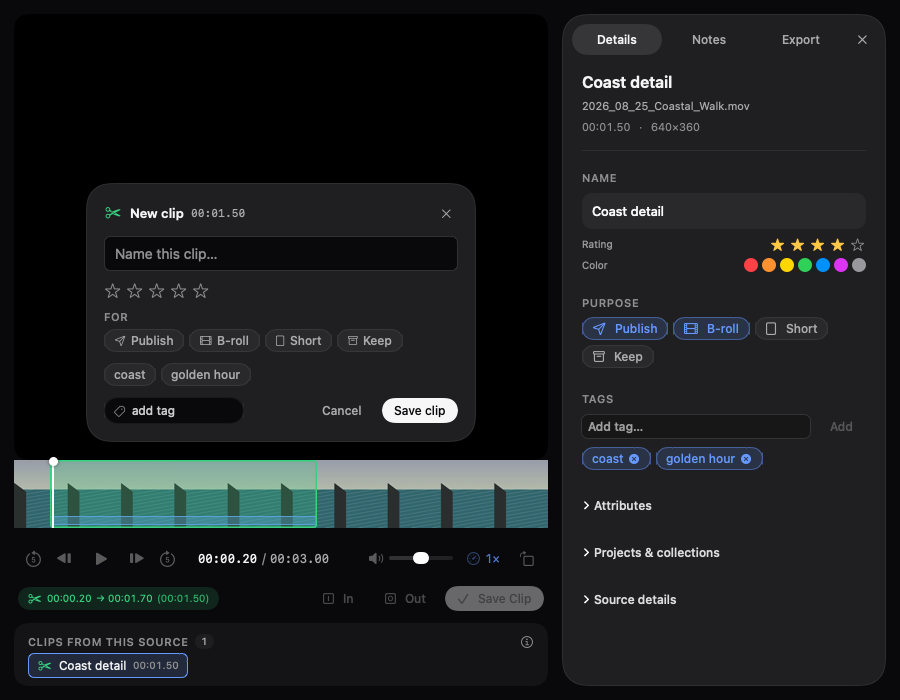
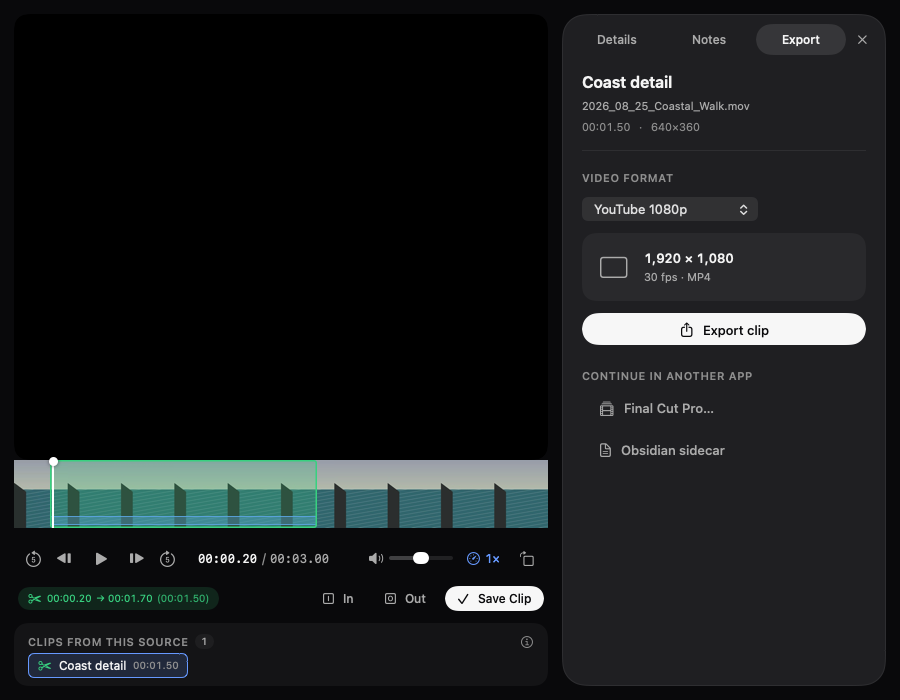
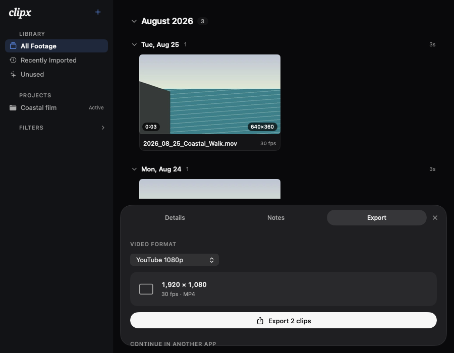

# Stint-inspired native workspace

Clipx now gives footage the main workspace and keeps Details, Notes, and Export in one switchable panel. Opening footage collapses the source sidebar; the native sidebar toggle still exposes it, and returning to the library restores its prior visibility. The task panel moves below the content when the available detail width is under 780 points. SwiftUI's `AnyLayout` keeps the player and editor alive across that change.

The visual pass uses neutral elevated panels, quieter secondary controls, more spacing, and light Save/Export actions. Notes use the panel's available height. Export exposes its format and output dimensions before the action, with the same controls for a single clip or a batch. Pending drafts flush when changing tabs; save failures remain visible from every tab. The filmstrip, frame stepping, marking shortcuts, metadata, and existing export backends remain available.

## Verification

Xcode 27.2 (27B52), XcodeGen 2.46.0, Apple Silicon, macOS 14 deployment target. All app builds use `com.clipx.Clipx.Verification`, disabled code signing, and isolated temporary data. The Mac stayed locked and no security settings changed.

| Check | Result |
| --- | --- |
| Direct Debug app and unit-test build | Passed |
| MAS Debug app and unit-test build | Passed |
| Native XCUITest workflow build | Passed; execution remains deferred |
| Direct offscreen regression run | 20 tests passed, zero failures or skips |
| MAS offscreen regression run | 20 tests passed, zero failures or skips |
| Native layout captures | 33 states per variant; requested widths respected |
| Actual notes editor → Export → Notes | Pending NSTextView text reached SQLite before the 600 ms debounce and returned intact |
| Workspace resize across the panel breakpoint | Notes retained and the same AVPlayer instance remained mounted |

The standalone runner links the actual production and test objects with a CLI entry point. It runs mutation, search, playback, and native rendering tests without activating an app or showing a window. This is not proof of a normal app launch, mouse/keyboard automation, sandbox entitlements, or release signing. The full historical 186/180-test suites were not rerun.

- [Build results](build-results.txt)
- [Direct test output](direct-tests.log)
- [MAS test output](mas-tests.log)
- [Requested/actual geometry and capture method](native-layout.txt)

Run from the repository root, sequentially:

```sh
CLIPX_BUILD_ROOT=build/ui-workspace CLIPX_PACKAGES_DIR=build/ui-workspace/Packages ./Scripts/verify.sh doctor
CLIPX_BUILD_ROOT=build/ui-workspace CLIPX_PACKAGES_DIR=build/ui-workspace/Packages ./Scripts/verify.sh offscreen
CLIPX_BUILD_ROOT=build/ui-workspace CLIPX_PACKAGES_DIR=build/ui-workspace/Packages ./Scripts/verify.sh offscreen-mas
```

The native click workflow now checks editing across Details/Notes/Export and reads the resulting name, notes, and range from SQLite. It was compiled but was not executed while the Mac remained locked.

## Native screenshots

These are offscreen AppKit bitmaps of production SwiftUI views and generated fixture media. The main video appears black because AVPlayerLayer does not composite into this capture method; window/toolbars and some system materials are also absent. They establish layout within that limitation. The separate playback regressions exercised actual AVFoundation playback through EOF/replay.







The MacBook-signed 0.1.0-1 candidate is unchanged and does not contain this UI. A fresh release build must be signed and notarized before these changes can ship as a public app download. This pass did not publish a release or update feed.
